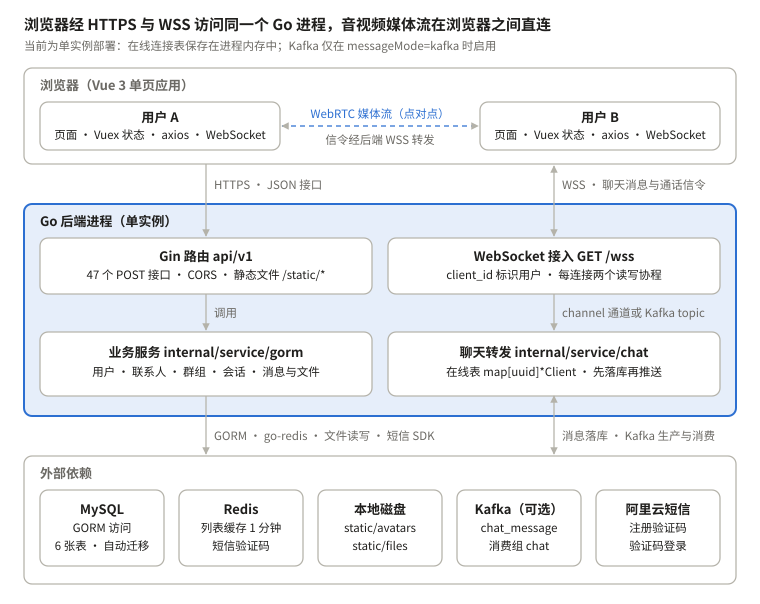

# MarsChat 架构总览

> **重构说明（2026-11-18）**：本文描述的是已移除的旧基线（截至提交 `6624cea`），只作参考。后端正在 `dev` 分支按 [后端重构计划](docs/plans/active/backend-refactor.md) 重写，目标架构见 [ADR-0005](docs/architecture/adr/0005-distributed-architecture.md)（其中的文件存储已被 [ADR-0007](docs/architecture/adr/0007-object-storage.md) 替代）和 [目标架构图](docs/images/proposed-distributed-architecture.svg)，当前代码见 [system.md](docs/architecture/system.md)（通话信令由 access 处理，见 [call-signaling.md](docs/design/call-signaling.md)；监控、链路追踪与压测见 [observability.md](docs/design/observability.md)）；本文将在重构中重写。



## 组成

| 部分                                          | 技术                                                             | 职责                                                                        |
| --------------------------------------------- | ---------------------------------------------------------------- | --------------------------------------------------------------------------- |
| 前端 `web/chat-server/`                     | Vue 3、Vuex、Vue Router、Element Plus、axios                     | 页面与交互；通过 HTTPS 调用接口，通过 WSS 收发消息和通话信令；WebRTC 音视频 |
| 后端 `cmd/` `api/` `internal/` `pkg/` | Go 1.27.3、Gin、GORM、go-redis、gorilla/websocket、kafka-go、zap | 业务接口、长连接管理、消息落库与转发、静态文件                              |
| 存储                                          | MySQL、Redis、本地磁盘                                           | 业务数据；列表缓存与验证码；头像与聊天文件                                  |
| 可选组件                                      | Kafka、TURN（coturn）                                            | 消息中转；公网音视频中继                                                    |
| 外部服务                                      | 阿里云短信                                                       | 注册与登录验证码                                                            |

## 后端模块关系

```
HTTP 请求 ─→ internal/https_server（Gin 路由与中间件）
              └→ api/v1（Controller，JsonBack 统一返回）
                   └→ internal/service/gorm（用户 / 联系人 / 群组 / 会话 / 消息）
                        ├→ internal/dao（GORM → MySQL）
                        ├→ internal/service/redis
                        └→ internal/service/sms（阿里云短信）

WSS 连接 ──→ api/v1/ws_controller → internal/service/chat
              Client（每连接 Read / Write 协程）
                └→ ChatServer（channel 模式）或 KafkaChatServer（kafka 模式，经 internal/service/kafka）
                     ├→ internal/dao（消息落库、读取群成员）
                     └→ internal/service/redis（追加消息缓存）
```

## 关键数据流

1. **普通业务请求**：浏览器 `POST` JSON → Controller → Service → Redis / MySQL → `{code, message, data}`。
2. **聊天消息**：浏览器经 WSS 发送 → `Client.Read` → 通道或 Kafka → 转发循环落库 → 推送给在线接收方并回显给发送方 → `Client.Write` 更新消息状态。离线消息只落库，打开会话时读取。
3. **音视频通话**：信令作为 `type=3` 消息经同一条 WSS 通道转发，媒体流在浏览器之间直连。

## 主要约束

- 单实例运行：在线连接表在进程内存中。
- 后端没有认证与鉴权。
- 本地依赖由 Compose 提供，应用仍在宿主机运行；配置及证书路径通过配置指定，其他环境相关项见部署文档。
- 本地显式启用 `httpEnabled` 时使用 HTTP / WS，无需证书；其他情况下使用 HTTPS / WSS。
- 前端依赖由 pnpm 管理，使用 `pnpm-lock.yaml` 锁定版本，迁移记录见 ADR-0004。

## 详细文档

| 主题                           | 文档                                                              |
| ------------------------------ | ----------------------------------------------------------------- |
| 分层、目录、技术组件、横切约定 | [docs/architecture/system.md](docs/architecture/system.md)         |
| 表结构、枚举、Redis 键         | [docs/architecture/data-model.md](docs/architecture/data-model.md) |
| 请求、消息、信令的流转与格式   | [docs/architecture/data-flow.md](docs/architecture/data-flow.md)   |
| 架构决策记录                   | [docs/architecture/adr/](docs/architecture/adr/README.md)          |
| 部署与配置                     | [docs/deployment.md](docs/deployment.md)                           |
| 已知问题                       | [docs/plans/tech-debt.md](docs/plans/tech-debt.md)                 |
