<div align="center">

# MarsChat

**让每一条消息都准时抵达**

在浏览器里使用的即时通讯系统：Go 微服务后端，React 前端。<br>
实现了可靠消息投递、多端同步和一对一音视频通话，并用故障实验和压测做了验证。

[功能](#功能) · [界面预览](#界面预览) · [架构](#架构) · [快速开始](#快速开始) · [文档](#文档)

</div>


## 功能

| 模块 | 能做什么 |
|---|---|
| 账号 | 邮箱验证码注册，密码或验证码登录；多设备同时在线，可以查看登录设备并让其中一台下线 |
| 消息 | 单聊和群聊，支持文字、表情、图片和文件；未读数与已读回执；同一账号的多个设备实时同步，断线重连后自动补齐 |
| 联系人与群组 | 好友申请与审批、黑名单；建群、入群审核、邀请、管理员、禁言、转让群主、解散 |
| 音视频通话 | 一对一语音和视频，多个设备同时响铃，在一台上接听；通话结束后在聊天里留下记录，点击即可回拨 |
| 设置与管理 | 资料与头像，明暗主题与字体，系统通知；管理员可以封禁用户，被封禁的账号所有设备立即下线 |

每项功能的实现状态和验证方式见 [features.md](docs/product/features.md)。

### 工程上的重点

- **可靠消息**：`client_msg_id` 保证重发只存一条，消息在会话内按 seq 有序，写库与发布事件在同一个事务里（Outbox）。推送尽力而为，客户端发现 seq 有缺口时补拉。
- **多实例投递**：Redis 记录每个连接所在的接入节点，事件经 Kafka 由 delivery 推送到对应节点。接入节点停机前先从注册中心注销，再分批通知客户端重连。
- **故障实验**：在容器模式下杀掉接入节点、滚动重启、杀掉 delivery、杀掉持有 Outbox 租约的实例、暂停 Kafka、停掉 Redis，以及通话中杀掉接听方的节点。每项实验结束后都核对历史消息，已确认的消息没有丢失或重复（[实验结果](docs/plans/completed/backend-refactor.md#故障实验结果)）。
- **压测基线**：在一台开发机的 Docker Desktop 上，1000 个在线连接、约每秒 1000 条消息时，推送 P99 约 300 ms，没有错误；瓶颈在 MySQL 的写路径（[压测结果](docs/plans/completed/backend-refactor.md#压测结果)）。
- **缓存与限流**：布隆过滤器和空值标记防穿透，重建锁防击穿，TTL 抖动防雪崩；网关按 IP 限流，服务按用户限流。
- **可观测**：Prometheus 指标与告警、Grafana 看板、Jaeger 链路追踪（跨 Kafka）、慢查询日志。

## 界面预览

### 桌面端

<table>
  <tr>
    <td width="50%"></td>
    <td width="50%">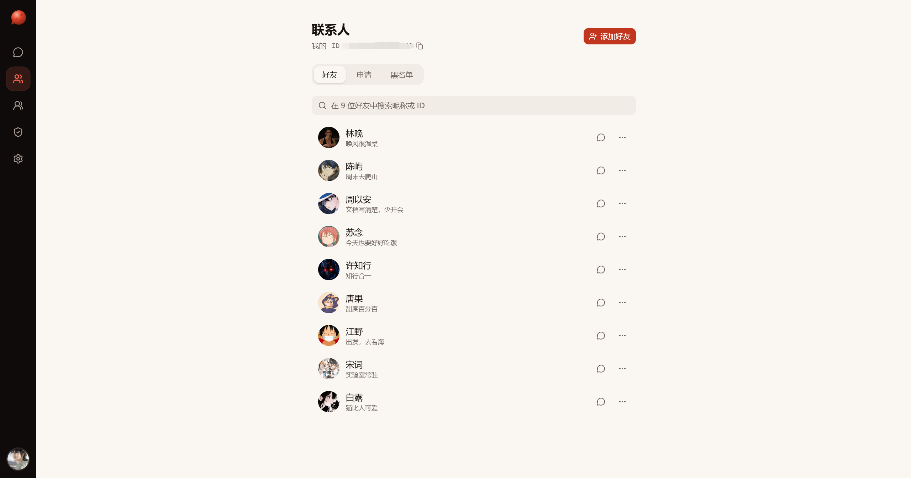</td>
  </tr>
  <tr>
    <td align="center">消息：会话列表</td>
    <td align="center">联系人：好友、申请与黑名单</td>
  </tr>
  <tr>
    <td>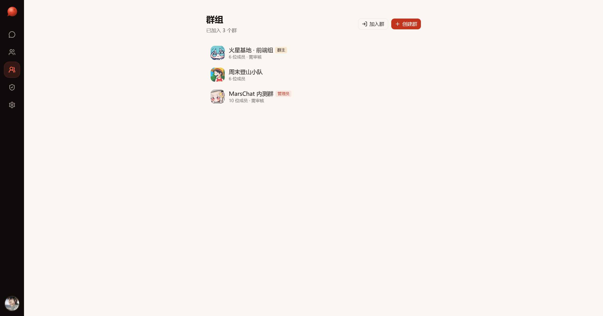</td>
    <td>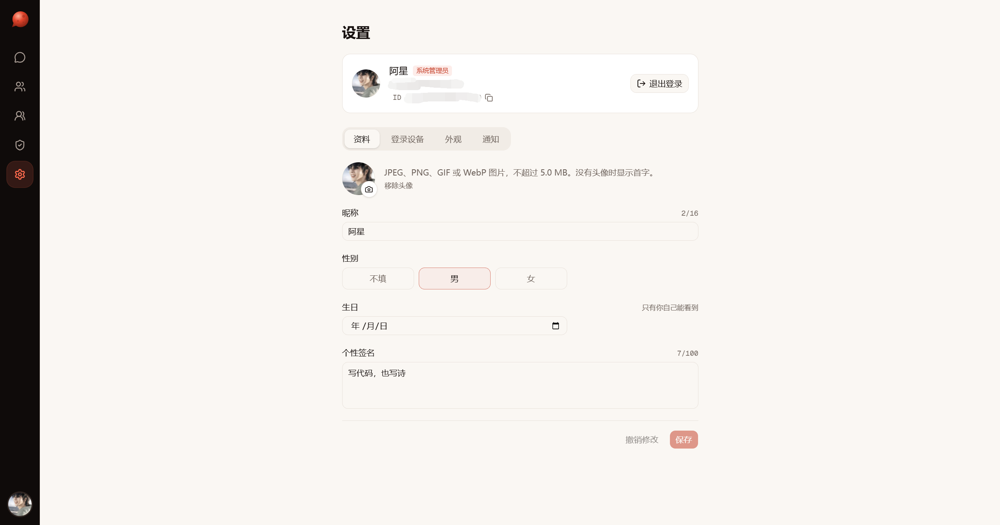</td>
  </tr>
  <tr>
    <td align="center">群组：标出自己的角色和是否需要审核</td>
    <td align="center">设置：资料与头像</td>
  </tr>
  <tr>
    <td>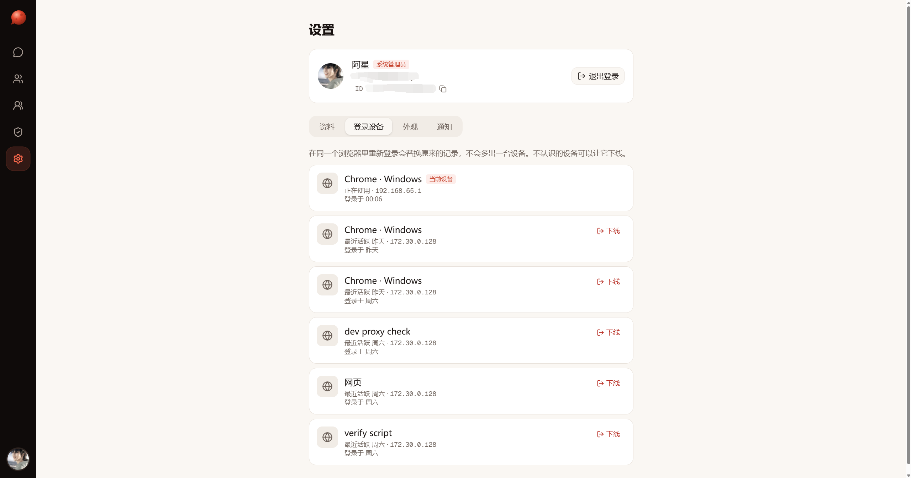</td>
    <td>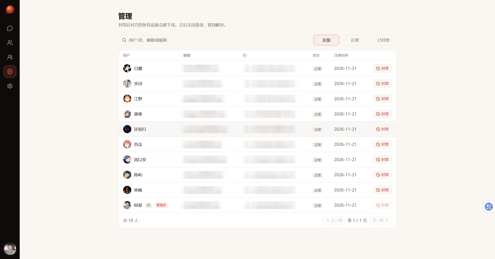</td>
  </tr>
  <tr>
    <td align="center">设置：登录设备，可以让其他设备下线</td>
    <td align="center">管理：用户列表与封禁</td>
  </tr>
</table>

### 手机浏览器

同一套前端在窄屏上改用底部导航。截图来自 Android 上的 Chrome，中文跟随系统字体（这台手机设置了书法字体）。

<table>
  <tr>
    <td align="center">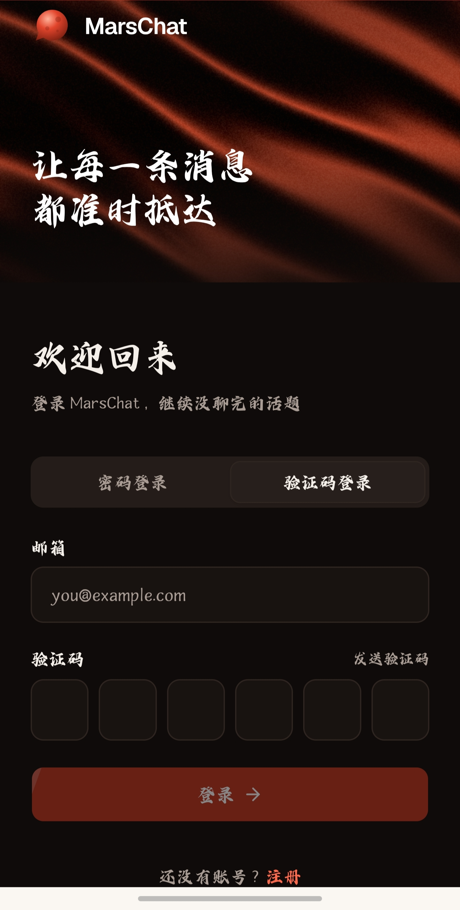<br>验证码登录</td>
    <td align="center"><br>会话列表</td>
    <td align="center">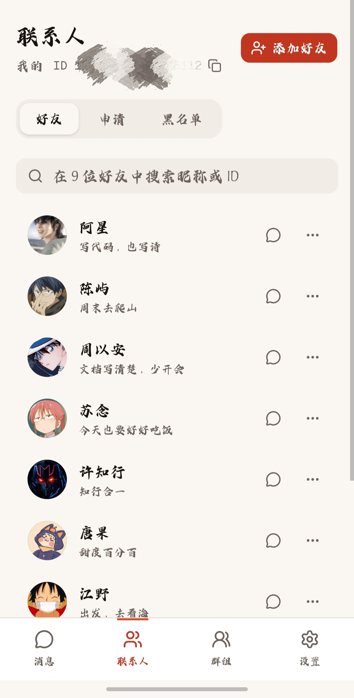<br>联系人</td>
  </tr>
  <tr>
    <td align="center">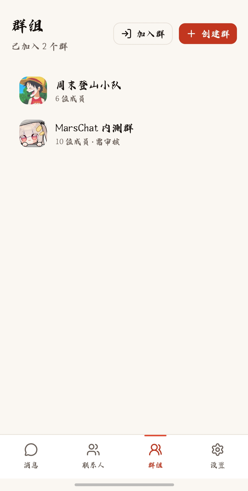<br>群组</td>
    <td align="center">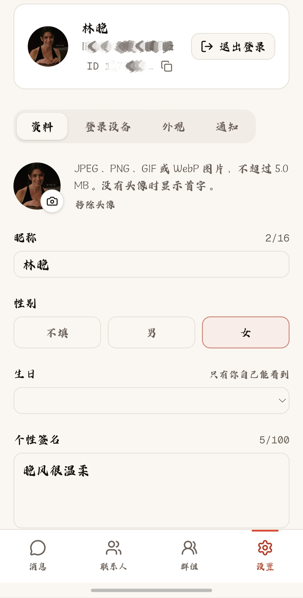<br>资料</td>
    <td align="center">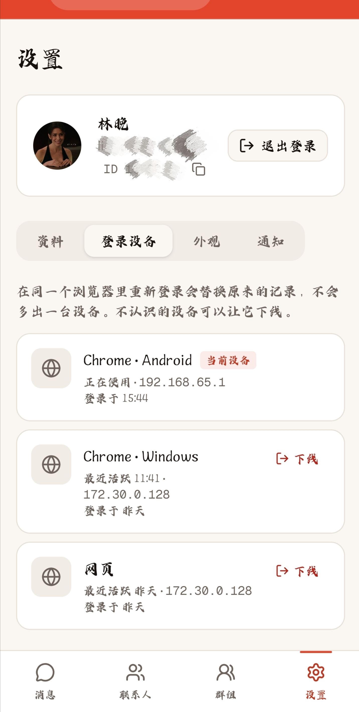<br>登录设备</td>
  </tr>
</table>

## 架构

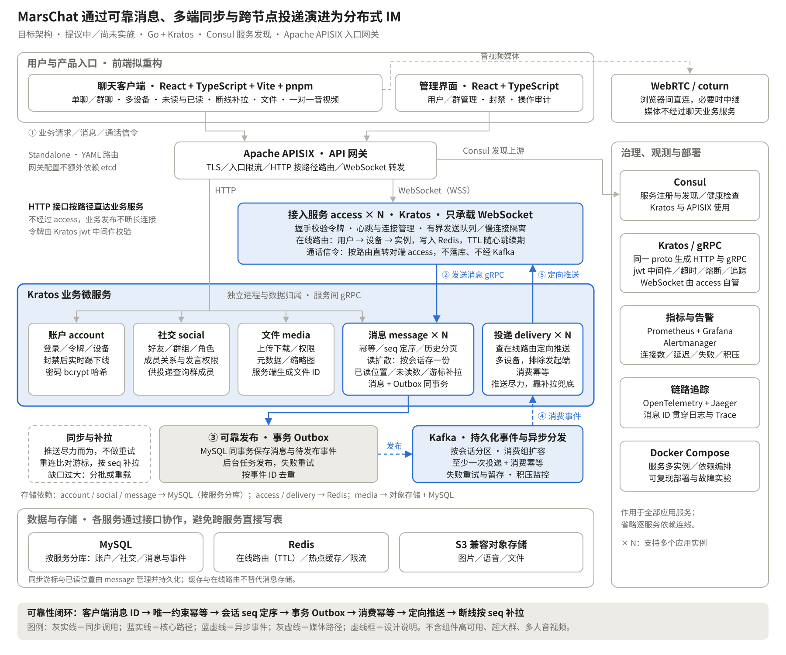

客户端经 APISIX 网关访问：HTTP 接口直达各业务服务，WebSocket 只连接入服务 access。message 在一个事务里写消息和 Outbox 事件，事件经 Kafka 由 delivery 推送到持有连接的 access 实例。通话信令在 access 之间直接转发，媒体走浏览器之间的 WebRTC，可选部署 coturn 中继。

| 服务 | 职责 |
|---|---|
| access | WebSocket 接入、心跳、在线路由、通话信令 |
| account | 验证码、注册登录、令牌、资料、设备、封禁 |
| social | 好友、申请、黑名单、群与成员角色 |
| message | 发送、会话列表与未读数、历史、补拉、已读位置 |
| delivery | 消费事件，推送到对应的 access 或踢下线 |
| media | 文件上传、缩略图、签名下载地址 |

服务划分、数据流与可靠性设计见 [ARCHITECTURE.md](ARCHITECTURE.md)，选型理由见 [ADR-0005](docs/architecture/adr/0005-distributed-architecture.md) 和 [ADR-0006](docs/architecture/adr/0006-message-sync-model.md)。

## 技术栈

| 层 | 技术 |
|---|---|
| 服务 | Go 1.27.3、Kratos v3（HTTP + gRPC，protobuf 契约）、wire、GORM、go-redis、franz-go、gorilla/websocket |
| 前端 | React、TypeScript、Vite、Tailwind CSS、shadcn/ui、TanStack Query、zustand、Vitest，pnpm 管理依赖（[ADR-0008](docs/architecture/adr/0008-react-frontend.md)） |
| 组件 | MySQL、Redis 8（含布隆过滤器）、Kafka、Consul、Apache APISIX，全部由 Docker Compose 提供 |
| 通话 | WebRTC，可选 coturn 中继 |
| 可观测 | OpenTelemetry、Prometheus、Alertmanager、Grafana、Jaeger；压测用 k6 |
| 存储 | 本地目录或阿里云 OSS |
| 工具 | buf、golang-migrate、GitHub Actions |

## 快速开始

需要 Go 1.27.3、Docker Desktop、buf 1.71.0、Node.js 与 pnpm，在 Git Bash 中执行：

```bash
cp .env.example .env    # 把 change-me 换成随机密码
make keys               # 生成 JWT 密钥等，写入 .env
make up                 # 启动 MySQL、Redis、Kafka、Consul
make migrate-account migrate-social migrate-message migrate-media
make images             # 构建服务镜像
make web-install        # 安装前端依赖
make web-image          # 构建前端镜像
make cluster-up         # 启动多实例服务、网关与前端，打开 http://localhost:19080
```

以下内容见 [deployment.md](docs/deployment.md)：

- 宿主机运行服务；
- 前端开发服务器；
- 设置管理员；
- 局域网访问与 HTTPS（浏览器只在 HTTPS 或 localhost 下开放麦克风和摄像头）；
- TURN 中继、验证码邮件、OSS 存储；
- 监控与压测。

开发检查命令见 [AGENTS.md](AGENTS.md#验证要求)。

## 文档

| 想了解 | 文档 |
|---|---|
| 架构总览 | [ARCHITECTURE.md](ARCHITECTURE.md) |
| 功能清单与实现状态 | [features.md](docs/product/features.md) |
| 各模块的流程、接口与代码位置 | [模块文档](docs/README.md#模块文档) |
| WebSocket 帧格式与通话信令 | [data-flow.md](docs/architecture/data-flow.md) |
| 表结构与 Redis 键 | [data-model.md](docs/architecture/data-model.md) |
| 架构决策 | [ADR 索引](docs/architecture/adr/README.md) |
| 前端设计 | [frontend.md](docs/design/frontend.md) |
| 部署与配置 | [deployment.md](docs/deployment.md) |
| 故障实验与压测数据 | [后端重构计划](docs/plans/completed/backend-refactor.md#故障实验结果) |
| 已知问题 | [tech-debt.md](docs/plans/tech-debt.md) |
| 全部文档 | [文档索引](docs/README.md) |
| Coding Agent 工作指南 | [AGENTS.md](AGENTS.md) |

## 许可证

[MIT License](LICENSE)。前端使用的第三方源码与许可证见 [THIRD_PARTY_NOTICES.md](web/THIRD_PARTY_NOTICES.md)。
