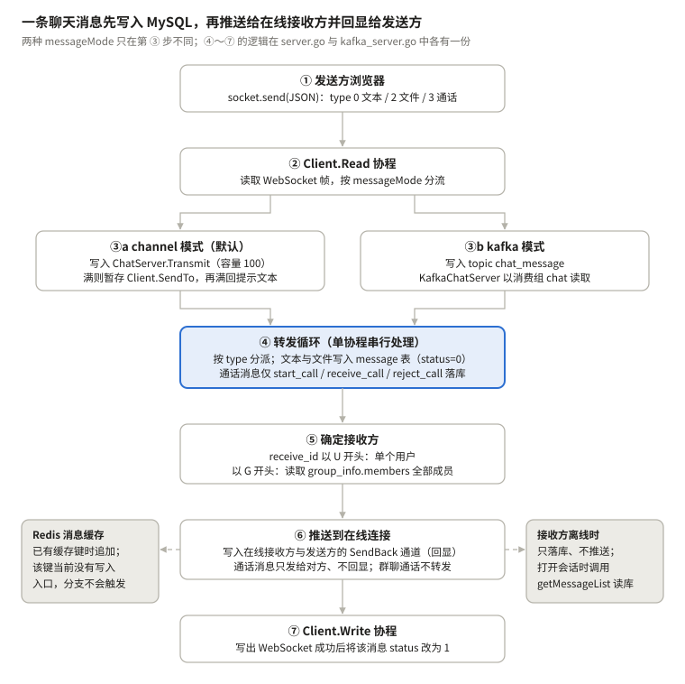
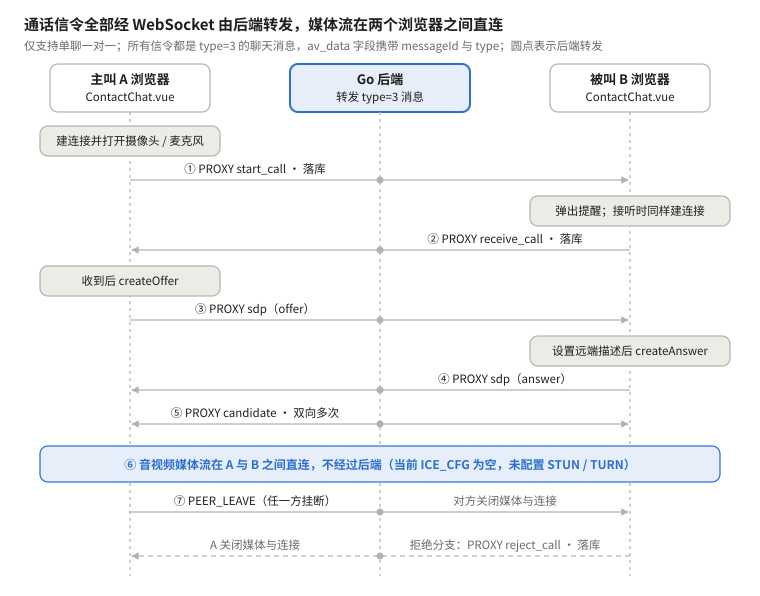

# 数据流

> 描述请求、消息和数据在模块之间如何流转。WebSocket 消息格式以本文为准。模块分层见 [system.md](system.md)，表与缓存键见 [data-model.md](data-model.md)。

## 1. HTTP 请求链路

```
浏览器 axios.post(backendUrl + path, JSON)
  → Gin 中间件：CORS（允许所有来源） → ssl.TlsHandler（HTTPS 重定向）
  → api/v1 Controller：c.BindJSON(&req)，绑定失败直接返回 code 500
  → service/gorm：业务校验 → Redis（部分列表接口）→ MySQL（GORM）
  → JsonBack(c, message, ret, data) → HTTP 200 + {code, message, data}
```

- 没有认证中间件：调用方身份完全由请求体里的 `owner_id`、`uuid` 等字段决定（TD-01）。
- 列表类接口采用“先读 Redis，未命中查 MySQL 再写回”的旁路缓存模式；写操作后删除相关键。哪些键真正生效见 [data-model.md](data-model.md#4-redis-键)。

## 2. 登录与建立长连接

1. 前端调用 `/login`、`/user/smsLogin` 或 `/register`，成功后把返回的用户信息存入 Vuex 和 `sessionStorage`。
2. 前端立即连接 `wss://<后端>/wss?client_id=<用户 uuid>`。
3. `WsLogin` 调用 `chat.NewClientInit`：升级为 WebSocket，创建 `Client{SendTo, SendBack}`（两个通道容量都是 100），投递到当前模式的 `Login` 通道，并启动 `Read`、`Write` 两个协程。
4. 转发服务把连接登记到在线表 `Clients[uuid]`，并回发纯文本 `欢迎来到mars聊天服务器`。
5. 页面刷新后由 `App.vue` 重新建立连接。主动退出时前端调用 `/user/wsLogout`，后端从在线表移除并关闭连接（kafka 模式下无效，TD-05）。

握手只校验 `client_id` 非空，不验证它是否属于当前用户。

## 3. 聊天消息流转



要点：

- 转发循环是**单协程串行**处理，数据库写入也在这个协程里同步完成。
- 消息先写 MySQL（`status=0`），`Client.Write` 成功写出 WebSocket 后再更新为 `status=1`。发送方的回显也会触发这次更新，因此 `status=1` 不代表接收方已收到。
- 发送方看到的自己的消息来自服务端回显，前端发送后不会本地插入（[ADR-0003](adr/0003-server-side-echo.md)）。
- 接收方离线时消息只落库；没有未读计数或上线推送，用户打开对应会话时通过历史接口读取。
- 前端每次进入聊天页都会覆盖 `socket.onmessage`，只把属于当前会话或自己发出的消息追加到界面，其他会话的消息不实时显示。

### 3.1 客户端 → 服务端消息格式

```json
{
  "session_id": "S...",
  "type": 0,
  "content": "文本内容",
  "url": "",
  "send_id": "U...",
  "send_name": "昵称",
  "send_avatar": "https://<后端>/static/avatars/x.png",
  "receive_id": "U... 或 G...",
  "file_size": "0B",
  "file_type": "",
  "file_name": "",
  "av_data": ""
}
```

对应 `internal/dto/request/chat_message_request.go`。`type`：0 文本、2 文件、3 通话信令；1（语音）没有处理分支，会被丢弃。

### 3.2 服务端 → 客户端消息格式

- 文本与文件消息：`GetMessageListRespond` / `GetGroupMessageListRespond` 的 JSON，字段为 `send_id`、`send_name`、`send_avatar`、`receive_id`、`type`、`content`、`url`、`file_size`、`file_name`、`file_type`、`created_at`（`yyyy-MM-dd HH:mm:ss`）。
- 通话信令：`AVMessageRespond`，在上述字段之外多一个 `av_data`。
- 纯文本帧：登录欢迎语、退出提示、通道已满时的失败提示。前端 `ContactChat.vue` 对收到的帧直接 `JSON.parse`，这些纯文本帧只在进入聊天页之前收到时才不会报错。

## 4. 历史消息

| 场景 | 接口                                                       | 查询条件                                                                     |
| ---- | ---------------------------------------------------------- | ---------------------------------------------------------------------------- |
| 单聊 | `/message/getMessageList` `{user_one_id, user_two_id}` | `(send=A AND receive=B) OR (send=B AND receive=A)`，按 `created_at` 升序 |
| 群聊 | `/message/getGroupMessageList` `{group_id}`            | `receive_id = 群 ID`，按 `created_at` 升序                               |

一次返回全部记录，没有分页。通话信令里落库的 `start_call` 等记录也会出现在单聊历史中（前端不渲染 `type=3`）。

## 5. 文件与头像上传

1. 前端 `el-upload` 以 multipart 方式 `POST /message/uploadFile` 或 `/message/uploadAvatar`。
2. 后端按**原文件名**写入 `static/files/` 或 `static/avatars/`，同名覆盖，不做大小和类型校验（TD-10）。
3. 上传成功后：
   - 聊天文件：前端发送一条 `type=2` 的 WebSocket 消息，`url` 为 `backendUrl + /static/files/<文件名>`。
   - 头像：前端把 `/static/avatars/<文件名>` 作为 `avatar` 字段提交给 `/user/updateUserInfo` 或建群、改群接口。
4. 下载通过 `/static/files/...` 直接访问，没有鉴权。

## 6. 音视频通话信令



信令都是 `type=3` 的聊天消息，`av_data` 是 JSON 字符串：

| messageId      | type             | 发送方 | 是否落库 | 接收方动作                                    |
| -------------- | ---------------- | ------ | -------- | --------------------------------------------- |
| `PROXY`      | `start_call`   | 主叫   | 是       | 提示来电，允许接听或拒绝                      |
| `PROXY`      | `receive_call` | 被叫   | 是       | 主叫 `createOffer`                          |
| `PROXY`      | `reject_call`  | 被叫   | 是       | 主叫结束通话                                  |
| `PROXY`      | `sdp`          | 双方   | 否       | `messageData.sdp.type` 为 offer 时回 answer |
| `PROXY`      | `candidate`    | 双方   | 否       | `addIceCandidate`                           |
| `PEER_LEAVE` | —               | 挂断方 | 否       | 对方结束通话                                  |

后端只把通话信令转发给 `U` 开头的接收方，且不回显给发送方（原因见 [lessons/av-signaling-no-echo.md](../lessons/av-signaling-no-echo.md)）。前端还处理 `CURRENT_PEERS`、`PEER_JOIN`，但后端从不发送这两种消息。

## 7. 退出流程

收到 SIGINT/SIGTERM 后，`main` 依次执行：关闭 Kafka（kafka 模式）→ `ChatServer.Close()` 关闭通道 → `DeleteAllRedisKeys()` 清空当前 Redis 库 → 进程结束。没有等待在途消息处理完成，也不主动关闭现有 WebSocket 连接（TD-06）。
