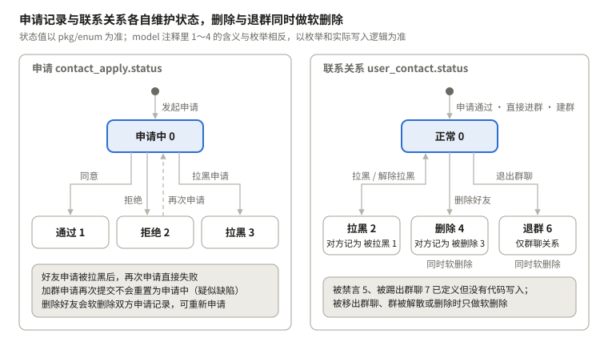

# 联系人与申请

> **重构说明（2026-11-19）**：“新实现”一节描述 social 服务的当前代码；其后各节描述已移除的旧基线（截至提交 `6624cea`），其中的代码位置已不存在，只作功能参考。

## 新实现（重构步骤 3）

social 服务的好友与拉黑部分，设计与规则细节见 [social-service.md](../../design/social-service.md)，功能状态见 [features.md](../features.md#新后端)，表与 Redis 键见 [data-model.md](../../architecture/data-model.md#22-socialmarschat_social迁移-000001_init)。入群申请见 [group.md](group.md#新实现重构步骤-3)。

| 层 | 位置 |
|---|---|
| 接口 | `api/social/v1/social.proto`、`internal.proto`、`error_reason.proto`、`events.proto` |
| 后端 | `app/social/internal/biz/friend.go`、`permission.go`；`app/social/internal/data/friend.go`、`account.go`（经 Consul 调用 account） |

与旧基线的主要差别：

- 当前用户取自访问令牌，只有接收方能处理申请（修正 TD-01）。
- 申请保留历史，被拒后再申请生成新记录，对方能看到；已是好友时不能再申请（修正 TD-17）。双方互相申请时直接成为好友。
- 拉黑是独立的单向关系，不删除好友关系，也不再有“拉黑申请”（直接拉黑申请人即可）。
- 好友关系与拉黑不缓存（都是主键查询），没有旧基线的缓存失效问题（TD-09）。
- 实时通知（重构步骤 5）：收到好友申请、成为好友、删除好友时，delivery 经 WebSocket 的 `Notification` 帧推给相关的在线用户，尽力推送，见 [data-flow.md](../../architecture/data-flow.md#54-好友与群通知)。拉黑不通知。

接口（全部需要登录，同名的 gRPC 方法见 proto；列表为游标分页，`cursor` 第一页传 0，`limit` 默认 20、最大 100）：

| 方法 | HTTP | 说明 |
|---|---|---|
| `SendFriendRequest` | `POST /v1/friend-requests` | `userId`、`message`；返回待处理申请，或 `becameFriends = true` |
| `ListReceivedFriendRequests` / `ListSentFriendRequests` | `GET /v1/friend-requests/received`、`/sent` | 收到的只有待处理的，发出的含全部状态；`peer` 为对方资料 |
| `AcceptFriendRequest` / `RejectFriendRequest` | `POST /v1/friend-requests/{request_id}/accept`、`/reject` | 仅接收方 |
| `ListFriends` | `GET /v1/friends` | 带资料 |
| `DeleteFriend` | `DELETE /v1/friends/{user_id}` | 幂等 |
| `BlockUser` / `UnblockUser` / `ListBlockedUsers` | `POST /v1/blocks`、`DELETE /v1/blocks/{user_id}`、`GET /v1/blocks` | 幂等 |
| `SocialInternalService.CheckSendPermission` | 仅 gRPC（内网） | 单聊：先查拉黑（`BLOCKED`），再查好友（`NOT_FRIENDS`）；群聊见 group.md |

错误原因见 [error_reason.proto](../../../api/social/v1/error_reason.proto)，HTTP 状态码规则见 [system.md](../../architecture/system.md#58-错误)。

## 职责

好友与群的申请、审批、拉黑，好友列表与已加入群列表，删除好友。群本身的管理见 [group.md](group.md)。

## 代码位置

| 层 | 位置 |
|---|---|
| 后端 | `api/v1/user_contact_controller.go`、`internal/service/gorm/user_contact_service.go` |
| 前端 | `views/chat/contact/ContactList.vue`、`components/ContactListModal.vue`、`ContactChat.vue`（删除、拉黑操作） |

## 数据与状态

- `contact_apply`：申请记录，同一对 (申请人, 目标) 复用一条。
- `user_contact`：联系关系。好友双向各一条记录；群关系只有“用户 → 群”一条。

状态取值见 [data-model.md](../../architecture/data-model.md#旧基线枚举)。

## 核心流程

1. **申请**：用户输入对方的用户 ID（`U...`）或群 ID（`G...`）及可选理由，调用 `/contact/applyContact`。目标被禁用时失败；好友申请曾被拉黑时失败。
2. **加群的两种方式**：前端先调用 `/group/checkGroupAddMode`。直接加入（`add_mode=0`）时调用 `/group/enterGroupDirectly`；需审核（`add_mode=1`）时走申请流程，由群主在聊天页处理。
3. **审批**：被申请人（或群主）通过 `/contact/getNewContactList`、`/contact/getAddGroupList` 查看待处理申请，可同意、拒绝或拉黑申请。同意好友申请会创建双向联系关系；同意加群申请会创建一条联系关系并把用户加入 `group_info.members`。
4. **拉黑 / 解除拉黑**：只改双方 `user_contact.status`，同时软删除操作者一方的会话。解除时要求双方状态确实是“拉黑 / 被拉黑”。
5. **删除好友**：双方联系关系标记为删除 / 被删除并软删除，双方会话与申请记录也软删除，之后可以重新申请。
6. **发起会话前检查**：`/session/checkOpenSessionAllowed` 会拒绝拉黑或被拉黑的关系，以及已被禁用的用户或群。

## 接口

| 路径 | 请求字段 | 说明 |
|---|---|---|
| `/contact/getUserList` | `owner_id` | 好友列表（带 Redis 缓存） |
| `/contact/loadMyJoinedGroup` | `owner_id` | 我加入的群（不含自己创建的，带缓存） |
| `/contact/getContactInfo` | `contact_id` | 用户或群资料；对方被禁用时返回业务错误 |
| `/contact/applyContact` | `owner_id`、`contact_id`、`message` | 申请加好友或加群 |
| `/contact/getNewContactList` | `owner_id` | 我收到的待处理好友申请 |
| `/contact/getAddGroupList` | `group_id` | 某群待处理的加群申请 |
| `/contact/passContactApply` | `owner_id`、`contact_id` | 同意。`owner_id` 为当前用户 ID（好友申请）或群 ID（加群申请），`contact_id` 为申请人 |
| `/contact/refuseContactApply` | 同上 | 拒绝 |
| `/contact/blackApply` | 同上 | 拉黑申请 |
| `/contact/deleteContact` | `owner_id`、`contact_id` | 删除好友 |
| `/contact/blackContact` | `owner_id`、`contact_id` | 拉黑 |
| `/contact/cancelBlackContact` | `owner_id`、`contact_id` | 解除拉黑 |

## 相关问题

TD-01（审批接口不校验操作者身份）、TD-09（缓存失效不完整）、TD-17（重复申请的状态处理）、TD-18（搜索框无过滤逻辑）、TD-19（状态注释与枚举不一致）。
